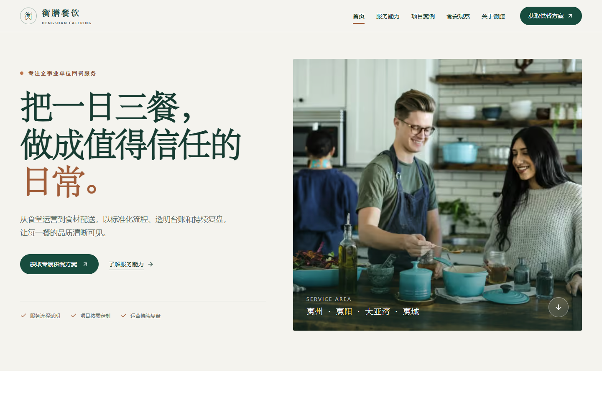
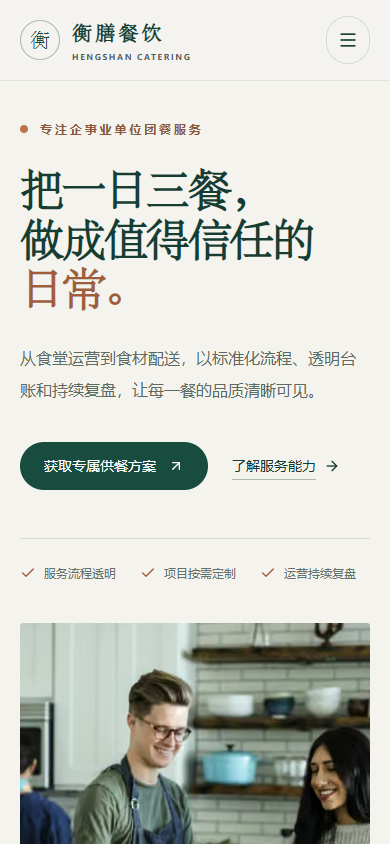
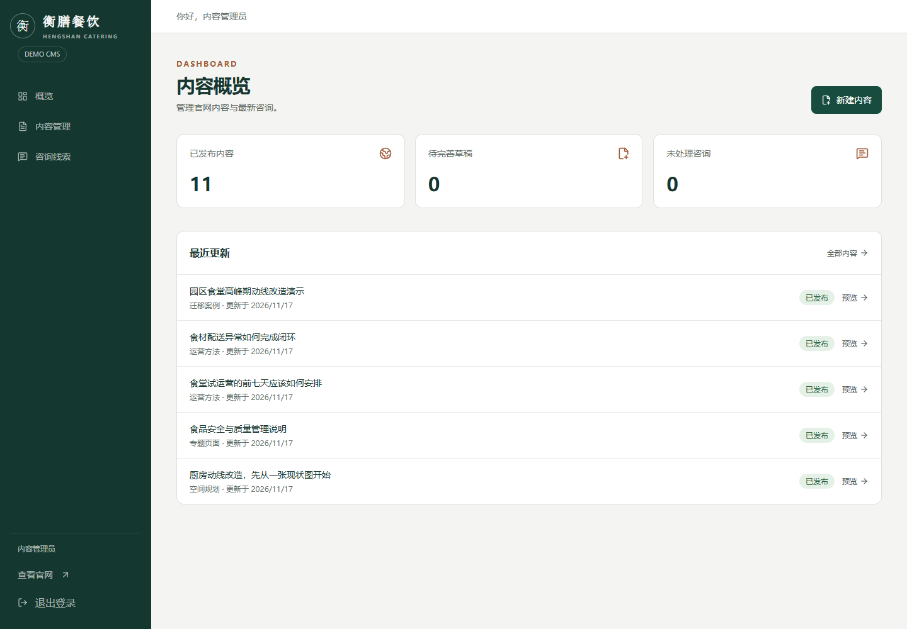

# 衡膳 · 餐饮企业老站现代化改造

一个围绕真实老站改造需求完成的独立全栈作品：响应式企业官网、轻量 CMS、旧内容迁移、301 重定向、技术 SEO 与 HTTPS 部署。

> 本项目基于公开招聘需求独立开发。“衡膳”为虚构演示品牌，案例与业务信息均为原创演示，不代表任何真实企业或客户委托。

## 项目展示

| 桌面端首页                                       | 移动端首页                                      | 内容管理后台                                      |
| ------------------------------------------------ | ----------------------------------------------- | ------------------------------------------------- |
|  |  |  |

## 需求如何落地

| 老站问题             | 本项目的实现                                                               |
| -------------------- | -------------------------------------------------------------------------- |
| 全站 HTTP            | Caddy 自动申请与续期 HTTPS 证书，HTTP 自动跳转 HTTPS，生产环境启用 HSTS    |
| CMS 不支持自定义模板 | 文章、案例、自定义页面统一建模，支持标准/专题模板                          |
| 无法自定义 head      | 每页独立 SEO 标题、描述、canonical、Open Graph，自动生成站点地图与 robots  |
| 无移动端适配         | 同一语义导航树自适应容器宽度，移动端使用原生 Popover；完整桌面与手机端 E2E |
| 标题关键词堆砌       | 标题以页面主题为主，保留独立 SEO 字段，不生成重复关键词标题                |
| 无关文章与重复内容   | 可重复执行的迁移脚本，按业务规则过滤并基于规范化标题和正文 SHA-256 去重    |
| 旧链接失效           | 精确匹配路径与查询参数，返回真实 HTTP 301；未登记旧链接返回 404            |
| 内容更新依赖开发者   | 登录保护的内容后台，支持草稿、发布、编辑、删除、封面上传和咨询线索管理     |

## 功能范围

- 官网：首页、四项服务及详情、案例、文章搜索、自定义页面、关于、联系表单、404。
- CMS：签名 HttpOnly 会话、scrypt 密码哈希、账号/IP 限流、内容 CRUD、Markdown 正文、图片上传、咨询状态与隐私删除。
- SEO：动态 Metadata、JSON-LD、sitemap、robots、canonical、旧链接 301。
- 工程：TypeScript strict、ESLint、Prettier、Vitest、Playwright、axe-core、GitHub Actions。
- 部署：本地 SQLite 零外部服务演示；生产 PostgreSQL 迁移、Docker 多阶段构建、Caddy 自动 HTTPS。

## 技术栈

Next.js 16 · React 19 · TypeScript · Tailwind CSS 4 · Prisma 6 · SQLite / PostgreSQL · Zod · Docker · Caddy

## 本地运行

要求：Node.js 26+、npm 11+。

```bash
cp .env.example .env
npm ci
npm run db:setup
npm run dev
```

Windows 可使用 `copy .env.example .env`。打开：

- 官网：`http://localhost:3000`
- 后台：`http://localhost:3000/admin/login`
- 演示账号：`admin@hengshan.demo`
- 演示密码：`Demo!2026`

`db:setup` 会创建本地 SQLite 数据库并写入 8 条原创内容和演示管理员。演示账号仅用于本地或公开演示环境，正式部署必须替换。

## 验证

```bash
npm run check             # 格式、Lint、类型、单元测试、生产构建
npx playwright install chromium firefox webkit
npm run test:e2e          # Chromium：桌面 + 手机端完整工作流
PLAYWRIGHT_BROWSER=firefox npm run test:e2e
PLAYWRIGHT_BROWSER=webkit npm run test:e2e
npm run test:load         # 需先启动本地 Docker HTTPS 服务
npm run migrate:legacy -- --dry-run
```

E2E 会真实启动应用并操作数据库：提交咨询、创建草稿、上传封面、发布内容、验证前台页面，最后删除测试内容。当前基线为 **25 项单元测试**，以及 Chromium、Firefox、WebKit **各 30 项桌面/移动端测试**。耐久测试覆盖 **20,000 请求、50 并发**，结果见 `reports/load-check.json`。

若要对已启动的 Docker 服务验收，可设置 `E2E_BASE_URL=https://localhost` 后运行 `npm run test:e2e`。

## 真实体验审计

最终版经过桌面/手机访客路径、键盘操作、表单、CMS 和容器内生产环境检查，并据此完成以下迭代：

- 缩短并重排服务标题，使用定向 `text-wrap: balance`，避免中文词语被拆成孤行。
- 手机联系页优先展示表单，联系方式置于其后，减少提交需求前的无效滚动。
- 导航只监听容器尺寸，避免打开 Popover 时触发自身重排。
- 草稿显示“发布后预览”，不再提供必然 404 的公开链接。
- 清理页面标题中的重复品牌名，保持搜索结果简洁。

Lighthouse 实测（本地生产容器）：桌面性能 **100**；移动端性能 **99**；两端可访问性、最佳实践、SEO 均为 **100**。报告位于 `reports/lighthouse-*.report.html`，可通过 `npm run audit:lighthouse` 复测移动端。

## 旧站迁移

```bash
npm run migrate:legacy -- --dry-run  # 只分析和生成报告
npm run migrate:legacy               # 幂等导入；默认保留已有编辑内容
npm run migrate:legacy -- --overwrite # 明确允许用旧站数据覆盖同 slug 内容
```

输入位于 `legacy/export.json`，输出包括：

- `legacy/redirects.generated.json`：旧 URL 到新 URL 的映射，由 `src/proxy.ts` 执行 301。
- `reports/legacy-migration.json`：每条记录的导入/跳过决定及原因。

样例数据共 6 条：导入 3 条、过滤 2 条养生内容、识别 1 条重复内容。真实迁移前必须备份数据库，并由业务方复核过滤规则。

## 部署

生产环境使用 PostgreSQL、独立迁移任务和持久化上传目录。完整步骤见 [部署说明](docs/deployment.md)。

```bash
cp .env.example .env
# 设置生产 DATABASE_URL 对应值、POSTGRES_PASSWORD、AUTH_SECRET、ADMIN_PASSWORD、DOMAIN、NEXT_PUBLIC_SITE_URL
docker compose up --build -d
```

`.env` 中的本地 `DATABASE_URL` 不直接传给 Compose；Compose 会使用 `POSTGRES_PASSWORD` 构造生产连接串。域名 DNS 必须已指向服务器，并开放 80/443 端口。

## 文档与目录

- [深度迭代记录](docs/iteration-log.md)
- [架构与安全](docs/architecture.md)
- [部署与上线检查](docs/deployment.md)
- [旧站迁移策略](docs/legacy-migration.md)
- [图片素材来源](public/images/ATTRIBUTION.md)

```text
src/app/(site)              官网与详情页
src/app/admin               登录与 CMS
src/components              共享展示组件
src/lib                     数据、认证、校验与迁移逻辑
prisma                      SQLite/PostgreSQL 模型、种子与生产迁移
legacy                      模拟旧站导出与重定向映射
scripts                     可执行迁移入口
tests                       单元测试与 Playwright E2E
```

## 明确的边界

- 本项目没有真实客户授权，不展示虚构的经营年限、资质、客户数或业务成果。
- 表单只入库，不发送邮件或短信；正式使用需接入通知渠道与隐私政策。
- 登录与咨询限流使用进程内存，单实例演示足够；多实例生产环境应改用 Redis 等共享存储。
- 上传文件需要持久化磁盘；部署到 Serverless 平台时应替换为对象存储。
- 自动化无障碍检查不能替代键盘、读屏软件和真实用户测试。

## License

MIT
